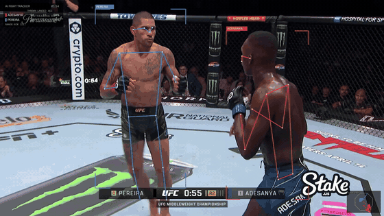

# mma-vision

Strike detection and fight stats from MMA broadcast footage. Pose estimation on both fighters,
then rules over the geometry to decide what was thrown, whether it landed, and where.



Post-processed, not real-time. Runs on CPU, Apple Silicon (MPS) or CUDA. I develop it on an M4 Mac mini.
**Work in progress** - see [known problems](#known-problems) before trusting any number it prints.

## What it does

```
video -> YOLO26-pose + ByteTrack -> fighter keypoints -> strike detector -> metrics
                                                              |
                                   annotated.mp4 <- overlay <-+-> summary.png / summary.json
```

- finds both fighters and keeps red/blue identity through clinches and camera cuts
- detects punches and kicks, calls them landed / missed, head / body / leg
- per-fighter output, accuracy, pace, range (clinch / punch / kick), cage control, guard height
- renders a broadcast-style overlay (skeletons, strike flashes, live stat panel, cage minimap)
- optional commentary track written by an LLM from the event log and voiced with TTS

## Running it

```bash
git clone https://github.com/BinyamAbraha/mma-vision && cd mma-vision
python3 -m venv .venv && source .venv/bin/activate
pip install -r requirements.txt yt-dlp

# no model download, no footage - a scripted stick-figure fight that exercises everything after pose estimation
python scripts/make_synthetic.py
python -m mma_vision.pipeline rerender data/clips/synthetic.mp4

# the real thing: downloads a 90s slice of Adesanya vs Pereira 2 and runs the full pipeline
scripts/run_demo.sh --max-frames 300     # first 10 seconds
scripts/run_demo.sh                      # whole slice, ~2-3 min on an M4

# any other clip
scripts/download_clip.sh "https://youtube.com/watch?v=..." fight 00:10:00 00:12:00
python -m mma_vision.pipeline run data/clips/fight.mp4 --red "NAME" --blue "NAME"
```

Outputs land in `outputs/<clip>/`:

| file | what |
|---|---|
| `annotated.mp4` | the overlay video |
| `summary.png` | stat card (totals, by target, landed over time, range) |
| `summary.json` | all the numbers |
| `events.csv` | every strike with the features it was judged on |
| `candidates.csv` | every candidate motion, accepted or not, with `rejected_by`. Look here first when a strike is missed |
| `frames.csv` | per-frame distance, range, guard height, position |
| `tracks.parquet` | raw keypoints. Cached, so inference never re-runs unless the model or frame count changes |

Inference is the only slow step and it's cached. Change anything in `config.yaml` and
`python -m mma_vision.pipeline rerender <clip>` re-does analysis + overlay in seconds.

## How the strike detector works

No training data. For each fighter's wrists and ankles, every frame:

1. Speed of the limb tip, in torso-heights per frame (so thresholds survive camera zoom and body size).
2. Candidate = speed peak above threshold, moving toward the opponent, with real acceleration
   (one-frame keypoint jumps are rejected; they're the pose model re-attaching a glove to the wrong body).
3. Impact = closest approach to the opponent within a short window.
4. Gates: the limb must be extended at impact and must have travelled from where it was. Kicks must also
   lift the foot above the standing ankle - walking forward otherwise registers as leg kicks.
5. Landed if the tip reaches the target surface (head sphere, torso line, thigh/shin segments) or the opponent's
   head snaps. Body kicks additionally need the opponent's hips to move; 2D can't tell a short foot from a
   depth-offset one, but a landed teep shoves people.
6. Cooldowns per hand / per leg / per fighter, relaxed inside a combo window so 1-2-3s count as three.

All thresholds are in `config.yaml` with comments on what each one is for. The synthetic fight
(`scripts/make_synthetic.py`) has 16 scripted strikes, a walk-in, a 1-2-3 and a whiffed jab; the detector gets
16/16 with the right fighter, limb and landed call on 15. That's a sanity check, not a benchmark - see below.

## Who is who

Position can't keep red/blue straight when fighters collide, so each detection also gets a colour signature
(HSV histograms of shorts and torso). Per-frame assignment is 60% appearance / 40% position with hysteresis,
templates only update while the fighters are apart, and an offline pass (2-state Viterbi over the clip)
repairs any swap the live tracker fell for. Detections that look like neither fighter - the referee, after
a knockdown - are dropped rather than labelled. Red = the fighter on the left in the first second.

## Known problems

Found by watching the output on real footage. Each one that's been fixed has a regression test; these haven't.

- No elbows or knees yet. Close-range elbows barely move the wrist keypoint.
- Clinch work is unreliable. Keypoints get stolen between bodies, and a punch in the clinch looks like a shove.
- Ground strikes are counted but the pose model does poorly on a horizontal body. Don't trust those numbers.
- Blocked punches read as either landed or missed depending on where the guard catches them. Needs a third outcome.
- The minimap is image-space, not a true top-down view. Needs a homography from the cage floor lines.
- No benchmark against official stats yet. That's the next thing.

## Next

1. Benchmark one full round against the UFC Stats numbers for it.
2. A keyboard labelling tool over the cached keypoints, then ~500 labelled strikes across a few fights.
3. A small temporal classifier on keypoint windows to replace the rules (and get jab/cross/hook, elbows, knees).
4. Muay Thai: clinch state, knees, sweeps, and a scoring layer.

## Commentary (optional)

```bash
python -m mma_vision.pipeline run fight.mp4 --commentary              # template lines, offline
python -m mma_vision.pipeline run fight.mp4 --commentary --tts kokoro  # + local voice
```
Set `commentary.provider: claude` in `config.yaml` (needs `ANTHROPIC_API_KEY`) for broadcast-style lines
written from the event log. The script is written to `commentary.json` before any TTS runs, so you can edit it.

## Notes

- Footage: pick a wide, static camera angle. Hard cuts are handled but each one costs a few frames.
- `scripts/kaggle_run.ipynb` if you want a free GPU for full fights or the bigger pose models.
- Ultralytics is AGPL-3.0, so this is too. See `LICENSE`.
